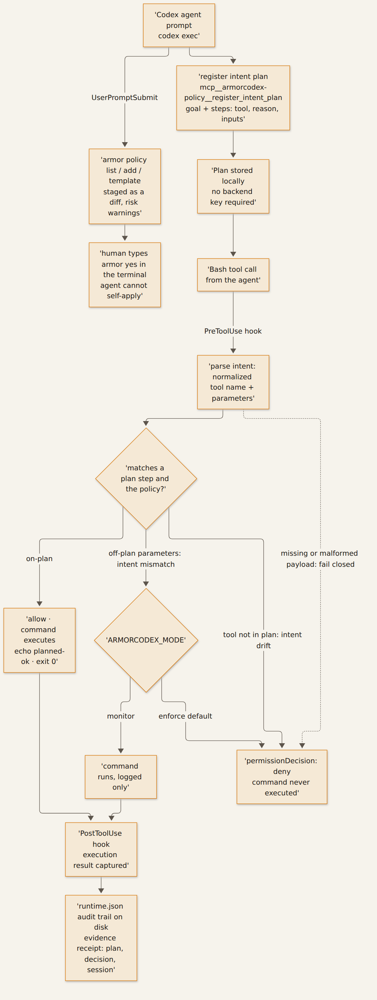

**[urelkdubdqwr](https://github.com/urelkdubdqwr)** · [website](https://studiopinggirkasur.xyz/)


**Intent-based Bash security for OpenAI Codex — this repo is the shipped First Dollar
bounty demo: enforcement evidence, demo videos, submission pack.**

Every Bash call the agent wants to run gets checked against a declared intent plan plus
policy rules *before* it executes. Drift gets denied at the hook layer — not asked
nicely in a prompt.

## What it is

[ArmorCodex](https://github.com/armoriq/armorCodex) wires four things into `~/.codex`
and self-verifies: `[features] hooks = true` in `config.toml`, the `armorcodex-policy`
MCP server, a global `hooks.json` (UserPromptSubmit / PreToolUse / PermissionRequest /
PostToolUse), and plugin deps. The installer signs off with
`✔ armorcodex is wired up correctly`.

This repo is what happened next: a headless Ubuntu box, Codex CLI driven from the
terminal, no ArmorIQ backend key (plan stored locally). What we actually saw —

- **On-plan runs clean.** A registered `Bash: echo planned-ok` step executes, exit 0.
- **Drift denied before execution.** Off-plan `whoami` comes back at the hook layer:

  ```json
  {"hookEventName":"PreToolUse","permissionDecision":"deny",
   "permissionDecisionReason":"ArmorCodex intent mismatch: parameters not allowed for Bash"}
  ```

  The command never runs; Codex reports the block honestly.
- **Two independent deny paths.** Parameter-level mismatch *and* tool-level
  `intent drift: tool not in plan (Bash)` — both observed in the same session.
- **`ARMORCODEX_MODE=monitor`** — the exact same drift session, logged instead of
  blocked. Clean A/B for a gradual team rollout.
- **Human-only apply gate.** Policy changes stage as a diff; applying requires a human
  typing `armor yes` in the terminal. The agent under guard can't lift its own guard.
- **100% local.** No account, no API key. Backend is optional (signed intent tokens +
  audit).

Gotchas, learned the hard way: Codex CLI ≥ 0.125 (0.80 prints `mcp ready` but silently
skips hooks), headless install needs
`ARMORIQ_API_KEY=*** ARMORCODEX_AUDIT_ENABLED=false`, and a failing bwrap sandbox can
mask enforcement before hooks ever see the command.

## How it works



- Codex registers an intent plan up front via
  `mcp__armorcodex-policy__register_intent_plan` — a goal plus steps carrying tool,
  reason and inputs.
- A Bash tool call hits the PreToolUse hook, which parses the normalized tool name and
  its parameters against that plan and the policy rules.
- On-plan → allow, the command runs. Off-plan → `ARMORCODEX_MODE` decides: `enforce`
  (default) denies at the hook layer, `monitor` lets it run and logs.
- Missing or malformed hook payloads fail closed: deny.
- PostToolUse captures the result and drains into the on-disk `runtime.json` audit
  trail — plan, decision, session. That file is the evidence receipt.
- Policy authoring stays separate from enforcement: `armor policy list`,
  `armor policy add deny bash`, `armor policy template lockdown`,
  `armor policy default deny` — typed as plain chat, staged as a diff, applied only by a
  human.

Honest scope: Bash-only today. Codex hooks don't intercept MCP / file-edit / web tools,
and their docs say so upfront.

## Quickstart

```bash
git clone https://github.com/urelkdubdqwr/bounty-armorcodex.git
cd bounty-armorcodex
```

Reproduce the demo (full setup log, challenges and fixes in [`REPORT.md`](REPORT.md)):

```bash
# 1. Install ArmorCodex from source, headless-friendly flags
git clone https://github.com/armoriq/armorCodex.git
cd armorCodex && npm install
ARMORIQ_API_KEY=*** ARMORCODEX_AUDIT_ENABLED=false bash install_armorcodex.sh --force-hooks

# 2. Register a 1-step plan, run it (passes), then drift (denied before exec)
codex exec "run: echo planned-ok, then whoami"

# 3. Same drift, log-only A/B
ARMORCODEX_MODE=monitor codex exec "run: whoami"
```

Needs: Node 26, Codex CLI ≥ 0.125, Ubuntu (tested headless).

## What's inside

| Path | What it is |
|---|---|
| [`REPORT.md`](REPORT.md) | Written report: setup steps, enforce vs monitor evidence, challenges faced & fixes, honest verdict. |
| [`SUBMISSION-PACK.md`](SUBMISSION-PACK.md) | Contest submission answers: tweet captions + form Q&A (with tweet links). |
| [`armorcodex_demo.mp4`](armorcodex_demo.mp4) | 60-sec demo video — voiceover, 6 scenes: install → enforce → monitor → policy walkthrough. |
| [`armorcodex_intent_guardrail.mp4`](armorcodex_intent_guardrail.mp4) | 69-sec outcome-first video: plan passes, drift denied, human-only policy gate. |
| [`armorcodex_intent_guardrail_x.mp4`](armorcodex_intent_guardrail_x.mp4) | X-post cut of the intent guardrail video. |
| `scripts/render_video.py` | The PIL + edge-tts + ffmpeg renderer that produced the 60-sec demo. |
| `scripts/render_video_v2.py` | v2 renderer for the outcome-led, under-2-min video. |
| `assets/` | `header.svg` banner and `diagram.mmd` → `ecosystem.png`, the guardrail flow above. |

## License

MIT — see [LICENSE](LICENSE). By ONAR-77.

*Worked from the edge of the bed. → [studiopinggirkasur.xyz](https://studiopinggirkasur.xyz/)*
