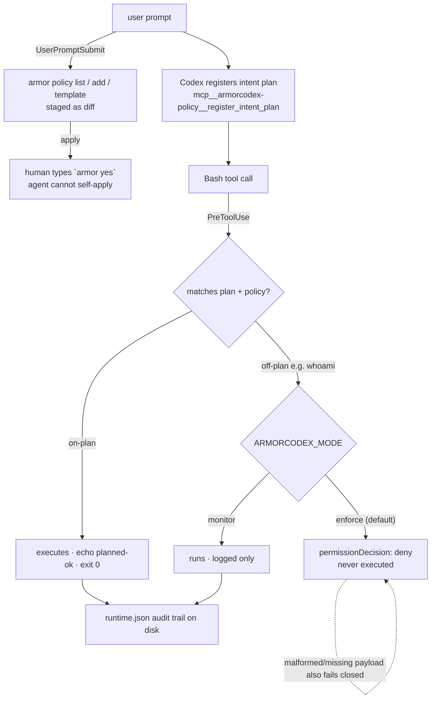

# bounty-armorcodex



**Intent-based Bash security for OpenAI Codex — this repo is the shipped First Dollar
bounty demo (Sep 2026): enforcement evidence, videos, and submission pack.**
Every Bash call gets checked against a declared intent plan + policy rules *before*
it runs; drift is denied at the hook layer, not asked nicely in a prompt.

## What it is

[ArmorCodex](https://github.com/armoriq/armorCodex) wires four things into `~/.codex`
and self-verifies: `[features] hooks = true` in `config.toml`, the `armorcodex-policy`
MCP server, global `hooks.json` (UserPromptSubmit / PreToolUse / PermissionRequest /
PostToolUse), and plugin deps. This repo proves what happens next:

- **On-plan passes** — a registered `Bash: echo planned-ok` step runs clean, exit 0.
- **Drift denied before execution** — off-plan `whoami` comes back at the hook layer:
  ```json
  {"hookEventName":"PreToolUse","permissionDecision":"deny",
   "permissionDecisionReason":"ArmorCodex intent mismatch: parameters not allowed for Bash"}
  ```
- **Two independent deny paths** — parameter-level mismatch *and* tool-level
  `intent drift: tool not in plan (Bash)`.
- **`ARMORCODEX_MODE=monitor`** — same drift session, logged instead of blocked. Clean
  A/B for gradual rollout.
- **Human-only apply gate** — policy changes stage as diffs; applying requires a human
  typing `armor yes` in the terminal. The agent under guard cannot lift its own guard.
- **100% local** — no backend account, no API key needed (backend = optional signed
  tokens + audit).

Gotchas found the hard way: needs Codex CLI ≥ 0.125 (0.80 silently skips hooks),
headless install needs `ARMORIQ_API_KEY=*** ARMORCODEX_AUDIT_ENABLED=false`, and
bwrap sandbox failures can mask enforcement in test results.

## How it works



enforce (default) blocks, monitor logs — one env var flips it. Details, evidence and
the full challenge/fix log live in [`REPORT.md`](REPORT.md).

## Quickstart

```bash
git clone https://github.com/urelkdubdqwr/bounty-armorcodex.git
cd bounty-armorcodex
```

Reproduce the demo (from [`REPORT.md`](REPORT.md)):

```bash
# 1. Install ArmorCodex from source (headless-friendly flags)
git clone https://github.com/armoriq/armorCodex.git
cd armorCodex && npm install
ARMORIQ_API_KEY=*** ARMORCODEX_AUDIT_ENABLED=false bash install_armorcodex.sh --force-hooks

# 2. Register a 1-step plan, run it (passes), then drift (denied before exec)
codex exec "run: echo planned-ok, then whoami"

# 3. Same drift, log-only A/B
ARMORCODEX_MODE=monitor codex exec "run: whoami"
```

Needs: Node 26, Codex CLI ≥ 0.125, Ubuntu (tested on a headless VPS).

## What's inside

| Path | What it is |
|---|---|
| [`REPORT.md`](REPORT.md) | Written report: setup steps, enforce vs monitor evidence, challenges faced & fixes, honest verdict. |
| [`SUBMISSION-PACK.md`](SUBMISSION-PACK.md) | Contest submission answers: tweet captions + form Q&A (with tweet links). |
| `armorcodex_demo.mp4` | 60-sec demo video — voiceover, 6 scenes: install → enforce → monitor → policy walkthrough. |
| `armorcodex_intent_guardrail.mp4` | 69-sec outcome-first video: plan passes, drift denied, human-only policy gate. |
| `armorcodex_intent_guardrail_x.mp4` | X-post cut of the intent guardrail video. |
| `scripts/render_video.py` | The PIL + edge-tts + ffmpeg renderer that produced `armorcodex_demo.mp4`. |
| `scripts/render_video_v2.py` | v2 renderer for the outcome-led, under-2-min video. |
| `assets/` | Generated header/rule SVGs (`gen_banner.py`). |

## License

MIT — see [LICENSE](LICENSE). By ONAR-77.
